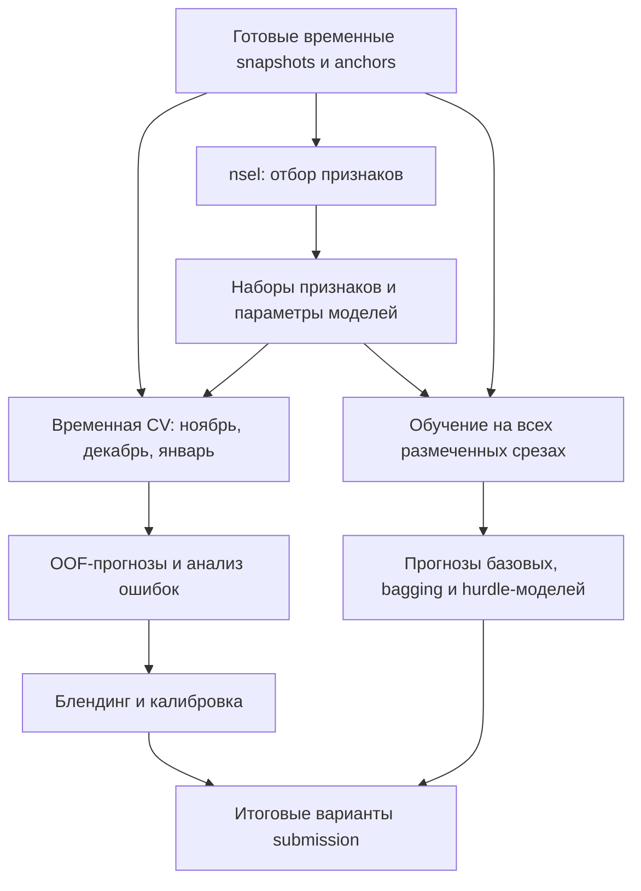

# E-CUP Students: Ozon Tech

## Ценность пользователей поиска — прогноз GMV на 30 дней

**Public leaderboard: 20th / 312 | Private leaderboard: 33rd / 312**

Моё решение для трека «Ценность пользователей поиска» соревнования [E-CUP Students 2026 от Ozon Tech](https://e-cup-ozon.ru/). Задача — по истории активности пользователя в Поиске и Каталоге предсказать суммарную стоимость его заказов за следующие 30 дней.

Основной ноутбук — **[final_solution.ipynb](final_solution.ipynb)**. В нём собраны обучение бустингов, временная кросс-валидация, анализ ошибок, bagging, hurdle-модели, блендинг и эксперименты с калибровкой итогового прогноза.

Отдельно опубликован **[отбор признаков nsel](feature_selection/)**: исходный серверный код, тот же pipeline в одном ноутбуке и результаты 12 сочетаний модели и преобразования таргета.

### Метрика и валидация

В решении используется RMSLE — среднеквадратичная ошибка в логарифмическом пространстве:

$$
\operatorname{RMSLE}(y,\hat y)=
\sqrt{\frac{1}{n}\sum_{i=1}^{n}
\left(\log(1+\hat y_i)-\log(1+y_i)\right)^2}.
$$

Оценка на валидации — взвешенная сумма RMSLE на трёх последовательных временных фолдах. Каждый фолд обучается только на предыдущих срезах.

| Фолд | Обучающие срезы | Валидационный срез | Вес |
| --- | --- | --- | ---: |
| Ноябрь 2025 | 16.09, 16.10 | 15.11.2025 | 0.25 |
| Декабрь 2025 | 16.09, 16.10, 15.11 | 15.12.2025 | 0.35 |
| Январь 2026 | 16.09, 16.10, 15.11, 15.12 | 14.01.2026 | 0.40 |

Финальные модели обучаются на всех пяти размеченных срезах с сентября по январь. Прогноз строится для среза от **13.02.2026**. Январь участвует в подборе решения, поэтому оценки на этих фолдах следует читать с учётом повторного использования валидации для экспериментов.

## Техническая сторона решения

### Отбор признаков

Для разных семейств моделей и преобразований таргета отбираются отдельные наборы признаков. В сохранённых серверных прогонах использовались **250 тысяч пользователей и 909 исходных признаков**.

Последовательность отбора:

1. **Null importance** — сравнение важностей с моделями на перемешанном таргете.
2. **Ranked forward selection** — добавление кандидатов по рангу с проверкой улучшения на временных фолдах и ограничениями на ухудшение отдельных сегментов.
3. **Парное спасение** — опциональная проверка пар кандидатов, которые не прошли по отдельности.
4. **Multiseed** — проверка выбранного набора целиком на сидах 42/52/62.
5. **Backward selection** — одна обратная чистка в конце.
6. **Optuna** — опциональный подбор гиперпараметров на той же схеме валидации.

Для серверных запусков предусмотрены пул процессов, разделяемые через `mmap` срезы, SQLite-кэш и продолжение после остановки. Категории для XGBoost и LightGBM обрабатываются ordered target encoding с эмпирико-байесовским сглаживанием; статистики строятся внутри обучающей части фолда.

**В [feature_selection/kod/](feature_selection/kod/) лежит оригинальный код отбора признаков, который прогонялся на серверах. В [nsel_otbor_priznakov.ipynb](feature_selection/nsel_otbor_priznakov.ipynb) я объединил весь pipeline из `kod/` в один ноутбук с пояснениями.** Ноутбук сначала записывает модули через `%%writefile`, чтобы multiprocessing со способом запуска `spawn` мог их импортировать.

Списки выбранных признаков, метрики по фолдам и история решений сохранены в [feature_selection/results/](feature_selection/results/). [Сводная таблица](feature_selection/results/rezultaty.md) содержит результаты всех 12 прогонов. Эти метрики относятся к щупам отбора признаков.

### Модели и преобразования таргета

Активная базовая часть `final_solution.ipynb` состоит из четырёх моделей с зафиксированными признаками и гиперпараметрами:

| Модель | Таргет | Признаков |
| --- | --- | ---: |
| XGBoost | `log_level` | 45 |
| CatBoost | `log_level` | 33 |
| CatBoost | `log_diff` | 54 |
| XGBoost | `log_diff` | 40 |

`log_level` — это `log1p(target_30d)`. `log_diff` — разность `log1p(target_30d)` и `log1p(gmv_30d)`: модель прогнозирует изменение относительно предыдущего 30-дневного GMV, после чего прогноз восстанавливается в исходный масштаб. Спецификации LightGBM также сохранены в ноутбуке, но отключены в его текущей конфигурации.

Поверх базовых моделей добавлены column bagging, регрессоры с разными весами наблюдений, Ridge-направление и иерархические ансамбли. Отдельная hurdle-ветка разделяет вероятность положительного таргета и величину покупки при положительном таргете; классификаторы дополняются калибровкой Platt.

### Блендинг и анализ ошибок

OOF-прогнозы базовых моделей используются для оптимизации весов и калибровок. В ноутбуке есть простые средние, ансамбли подмножеств моделей, cross-fitted веса, сегментные поправки и смешивание с учётом расхождения моделей.

Один из основных способов смешивания — взвешенное среднее в пространстве `log1p`:

$$
\hat y = \exp\left(\sum_{m=1}^{M} w_m\log(1+\hat y_m)\right)-1,
\qquad w_m\geq 0,\quad \sum_m w_m=1.
$$

Анализ ошибок включает сегменты нулевых и положительных таргетов, корреляции остатков, систематическое смещение, поведенческие сегменты, drift и ablation. Последние блоки сохраняют несколько экспериментальных вариантов посылок, в том числе смеси с прогнозами коллег и глобальной калибровкой. Точный файл, отправленный на итоговый лидерборд, отдельно в этих материалах не обозначен.



## Структура репозитория

```text
.
├── final_solution.ipynb                # полный ноутбук из full-final.ipynb
├── feature_selection/
│   ├── README.md                      # исходное описание архива nsel
│   ├── nsel_otbor_priznakov.ipynb      # весь pipeline отбора в одном ноутбуке
│   ├── kod/                           # исходный серверный пакет
│   │   ├── nsel/                      # данные, модели, кэш, пул и стадии отбора
│   │   ├── run_nsel.py                 # запуск отбора из командной строки
│   │   └── tools/build_adaptive_anchor.py
│   └── results/                       # 12 JSON-отчётов и сводная таблица
├── docs/notebook_comparison.md         # сравнение двух исходных ноутбуков
└── requirements.txt
```

## Запуск

### Основной ноутбук

Исходное окружение основного ноутбука — **Kaggle, Python 3.12.13, Linux**. Для повторного запуска нужно подключить:

| Вход | Содержимое |
| --- | --- |
| `kopt-data-private` | Шесть `snapshot_YYYYMMDD.parquet` с готовыми признаками |
| `kopt-anchor-all` | `anchor_segment_adaptive_YYYYMMDD.parquet` на те же даты |
| `samples` | Шаблон `sample_submit.csv` |
| Прогнозы коллег | Дополнительные CSV для внешних блендов в последних экспериментальных ячейках |

Открыть `final_solution.ipynb`, подключить входы и проверить конфигурацию в начале ноутбука. Для локального окружения пути задаются через `SNAPSHOT_DIR_OVERRIDE`, `ANCHOR_DIR_OVERRIDE`, `SAMPLE_SUBMISSION_OVERRIDE` и `OUTPUT_DIR`; отдельные поздние эксперименты также содержат собственные пути Kaggle.

Ноутбук читает уже рассчитанные snapshots: генерация исходных 909 признаков из сырых событий выполнялась отдельно. Данные, snapshots, anchors, обученные модели и CSV коллег в репозиторий не входят. Файлы с прогнозами и диагностикой при штатном запуске сохраняются в `/kaggle/working/ozon_final/`. Дополнительные adaptive-модели в разделе 30 по умолчанию отключены.

### Отбор признаков

Установить зависимости в отдельное Python-окружение:

```bash
python -m pip install -r requirements.txt
```

Серверный запуск на Linux из исходного пакета:

```bash
cd feature_selection/kod
python run_nsel.py --run-dir runs/catboost_log_level \
    --snapshot-dir /path/to/snapshots \
    --model catboost --target log_level --workers 4 --threads 2
```

Для notebook-варианта открыть `feature_selection/nsel_otbor_priznakov.ipynb` и запускать его из папки `feature_selection/`, чтобы рядом были доступны `kod/` и `results/`. В нём уже сохранены выводы исходной проверки на синтетических данных и раздел сверки с модульным кодом.

Полное обучение на соревновательных данных при подготовке репозитория повторно не запускалось: для него нужны перечисленные входы. При публикации проверены синтаксис Python, структура ноутбуков, результаты отбора и соответствие сохранённых исходников.

## Исходные материалы

- [Официальный сайт соревнования](https://e-cup-ozon.ru/).
- [Основной ноутбук на Kaggle: full-final](https://www.kaggle.com/code/vladimirsmirnovve/full-final).
- [Предыдущий вариант на Kaggle: blending-trials](https://www.kaggle.com/code/vladimirsmirnovve/blending-trials).
- [Почему выбран full-final](docs/notebook_comparison.md).
